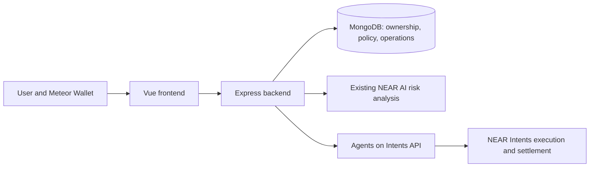

# SpendGuard AI

SpendGuard lets a user configure an AI trading agent without giving it unrestricted access to their funds. A verified NEAR wallet owns the agent, a signed policy limits spending, NEAR AI assesses each swap, and the backend binds approval to the exact request before submitting it to Agents on Intents.

## What works

- Meteor wallet ownership verification with NEP-413, full-access-key verification, and revocable HttpOnly sessions.
- Owner-scoped agents, versioned policies, exact token amounts, encrypted grant credentials, and wallet authorization reviews.
- Token catalog and available agent balances from the provider; backend enforcement of per-swap and rolling 24-hour spending limits.
- Dry-run swap previews, the existing NEAR AI `ALLOW`/`WARN`/`BLOCK` analysis, exact-operation approval, stable idempotency keys, and status reconciliation.
- Agent, policy, authorization, swap, and activity screens, with mobile navigation and retry states.
- Automated security and browser tests. Browser tests exercise the real Meteor SDK transport with synthetic wallet/provider responses.

**Live integration status:** a real Meteor ownership proof remains unconfirmed because the user's Meteor web wallet reports no locally available Mainnet account. Mainnet grant signing, funding, swap execution, and settlement have not been validated with real funds. Public submission is prepared as documentation and has not been published. Automated tests do not establish a completed mainnet integration.

## Architecture



The backend enforces ownership, grants, policy, balance, quote freshness, risk, and approval. NEAR AI is advisory and cannot override a failed mandatory check. Grant tokens and partner credentials stay on the backend; wallet private keys stay in Meteor. The original anonymous transaction-analysis endpoints remain available and exclude owner-linked operation records.

## Run the project locally

### 1. Install the prerequisites

- **Node.js 24 or newer**, with npm. The pinned Agents on Intents SDK requires Node 24+.
- **Git**, if you are cloning the repository.
- **MongoDB**, either a running local server or an Atlas development database. Its database user must be able to read/write documents and create indexes.
- **A Meteor Wallet Mainnet account** for interactive wallet verification and owner signatures.
- **A NEAR AI API key and model ID** for risk analysis, and **an Agents on Intents partner API key** for the agent and swap features.

MongoDB is required to start the backend. The two API integrations are configured separately: without their credentials, the server can start, but the corresponding features fail or remain held for review. Automated tests use synthetic services and wallets and can run without these live credentials.

### 2. Clone and install

```sh
git clone https://github.com/FatemehForoughi/spendguard-ai.git
cd spendguard-ai
npm run setup
```

If you already have the project, run `npm run setup` from its root directory. This command installs the locked backend and frontend dependencies and prepares `backend/.env` with a randomly generated grant-encryption key. New configurations have live execution disabled; existing credentials and settings are preserved.

On Windows PowerShell, use `npm.cmd` in place of `npm` if scripts are blocked:

```powershell
Set-Location 'E:\web projects\spendguard-ai'
npm.cmd run setup
```

### 3. Configure the backend

Open **`backend/.env`** and set the following values. Keep the `GRANT_ENCRYPTION_KEY` generated by setup in that file.

```dotenv
PORT=3000
CLIENT_URL=http://localhost:5173
NODE_ENV=development

# Example for a MongoDB server already running on your computer.
# Replace with your development Atlas URI if using Atlas.
MONGODB_URI=mongodb://127.0.0.1:27017/spendguard_dev

NEAR_AI_API_KEY=replace_with_your_near_ai_key
NEAR_AI_BASE_URL=https://cloud-api.near.ai/v1
NEAR_AI_MODEL=replace_with_a_model_id_available_to_your_near_ai_account

AGENTS_ON_INTENTS_PARTNER_API_KEY=replace_with_your_partner_key
AGENTS_ON_INTENTS_BASE_URL=https://api.agentsonintents.com
AGENTS_ON_INTENTS_TIMEOUT_MS=35000

NEAR_NETWORK_ID=mainnet
ENABLE_LIVE_EXECUTION=false
```

Replace the placeholder values with your credentials. For Atlas, create a database user, permit your development machine's IP in network access, and include a development database name in the connection URI. Installing the project's npm dependencies does not install or start MongoDB.

| Setting | Purpose |
| --- | --- |
| `MONGODB_URI` | Stores wallets, sessions, agents, policies, grants, and operations. |
| `NEAR_AI_API_KEY`, `NEAR_AI_MODEL` | Enables the existing NEAR AI risk analysis. Use an actual supported model ID. |
| `AGENTS_ON_INTENTS_PARTNER_API_KEY` | Partner credential issued by Agents on Intents; used by the backend only. |
| `GRANT_ENCRYPTION_KEY` | A 64-character hex key generated by setup; protects stored grant credentials. |
| `CLIENT_URL` | Exact frontend origin, including hostname and port; used for authentication and mutation checks. |
| `NEAR_NETWORK_ID` | Wallet verification network. Use `mainnet` for the agent/swap workflow; it requires Mainnet. |
| `NEAR_RPC_URL` | Optional trusted HTTPS RPC override; defaults to the selected network's public NEAR RPC. |
| `ENABLE_LIVE_EXECUTION` | Keep `false` for previews. Only `true` enables the separate swap execution action. |

Back up the encryption key privately and preserve it across restarts. Replacing it makes existing encrypted grants unreadable. Keep credentials in `backend/.env`, which is ignored by Git. Never put API keys, wallet secrets, or grant tokens in frontend `VITE_` variables.

No frontend environment file is needed for the default local setup. If you change the API port, create `frontend/.env` from [frontend/.env.example](frontend/.env.example), set `VITE_API_PROXY_TARGET` to the backend URL, and restart the frontend. Leave `VITE_API_BASE_URL` empty to use relative `/api` requests through the development proxy.

### 4. Start both apps

From the project root:

```sh
npm run dev
```

On Windows, the equivalent command is `npm.cmd run dev`. Keep the terminal running; **Ctrl+C** stops the development launcher.

| Address | Purpose |
| --- | --- |
| **http://localhost:5173** | SpendGuard frontend; open this address in your browser. |
| http://localhost:3000/api/health | Backend health check. |
| http://localhost:5173/api/health | Checks the backend through the frontend's development proxy. |

The backend should print `MongoDB connected successfully` followed by `SpendGuard API running at http://localhost:3000`. It starts listening only after MongoDB and its indexes initialize.

If you prefer separate terminals, run these from the project root instead of the combined launcher:

```sh
# Terminal 1
npm --prefix backend run dev
```

```sh
# Terminal 2
npm --prefix frontend run dev
```

Use one frontend and one backend process. Open `http://localhost:5173` consistently: switching to `127.0.0.1` or another port changes the browser origin and requires updating `CLIENT_URL` and restarting the backend.

### 5. Check the connection

Open both health-check addresses in the table above. Both should return JSON with `"success": true`. You can also check from PowerShell:

```powershell
Invoke-RestMethod 'http://localhost:3000/api/health'
Invoke-RestMethod 'http://localhost:5173/api/health'
Invoke-RestMethod 'http://localhost:5173/api/auth/session'
```

Before wallet verification, the session endpoint should return `{"success":true,"data":null}`. That is the normal signed-out state.

## How to use SpendGuard

Start with `ENABLE_LIVE_EXECUTION=false`. This prevents swap dispatch; signing an agent creation, policy, authorization, or revocation still submits that owner action to the real provider. The initial wallet ownership message authorizes no spending.

### Connect and verify your wallet

1. Open [Meteor Wallet](https://wallet.meteorwallet.app) in the same browser profile, unlock it, select **Mainnet**, and confirm your account appears in its account menu.
2. In SpendGuard, click **Connect wallet** and enter that NEAR account ID, such as `user.near`.
3. Click **Review ownership message**. Check the account, recipient, and expiry.
4. Click **Sign & verify in Meteor**. Select the same account and approve the displayed message in Meteor. Enter your wallet password only in Meteor; unlocking it alone does not approve the message.
5. Wait for SpendGuard to show **Ownership verified**. A submitted address becomes verified only after the backend validates its signature and on-chain full-access key.

The ownership challenge expires after five minutes. If it expires or you cancel, start a new verification attempt. Disconnecting revokes the SpendGuard session without deleting your agent records.

### Create an agent and spending policy

1. Open **Agents & Policies** and fill in the agent name, source and destination assets, and spending limits. Select tokens by their chain and asset ID, since the same symbol can appear on multiple chains.
2. For an initial public-balance workflow, select **Public** under **Agent balance** and keep **Require owner approval for each swap** checked.
3. Click **Prepare agent for signing**. Read the **Review owner authorization** panel, including the exact message and signing account.
4. Click **Review & sign in Meteor** and approve that exact owner action in the wallet.
5. Wait for provider confirmation. Use **Check original authorization** if it remains pending. The agent becomes `ACTIVE` only when the provider confirms its policy was applied.

For example, a USDC-to-NEAR policy could allow **10 USDC per swap** and **30 USDC per 24 hours**. These are illustrative limits; choose your own small development limits. Enter human-readable token amounts, such as `0.5`, rather than atomic units. Daily spending uses a rolling 24-hour window.

### Authorize the agent

1. Select the active agent in **Agents & Policies**.
2. In **Current policy & authorization**, enter an authorization label and expiry in hours.
3. Click **Prepare authorization**, review its exact message and expiry, then **Review & sign in Meteor**.
4. Confirm the authorization becomes `ACTIVE`. The backend encrypts its credential before storing it.

To change a policy, click **Load policy into form**, edit the values, then **Prepare policy update** and review/sign it. Once the new policy is active, create a new authorization for that policy version. To revoke one, click **Revoke authorization** and review/sign the provider revocation; local use is blocked immediately.

### Fund the agent separately

The **agent's available balance** is separate from your personal wallet balance. SpendGuard currently has no deposit screen and does not automatically transfer wallet funds into the agent.

Before a usable swap preview, fund the correct agent using the provider's [official deposit workflow](https://api.agentsonintents.com/llms.txt). The provider exposes `POST /v1/agents/{agent_id}/deposit` to request a deposit address; follow its documented asset/network instructions outside SpendGuard. This step requires a real transfer and should use a separate development wallet with a very small amount. A funded personal wallet alone will not satisfy the agent-balance check.

Open **Swaps**, select the agent, and click **Refresh** to check **Agent available balance**. The displayed source asset balance must cover the amount you want to preview.

### Request and review a swap

1. In **Swaps**, select the agent, **Sell** asset, **Buy** asset, **Amount to sell**, and a positive **Minimum amount to receive**.
2. Enter the amounts in their respective token units. The minimum output is your required floor, not an output estimate supplied by SpendGuard.
3. Click **Get preview & risk assessment**. The backend checks ownership, authorization, policy, limits, and available balance before requesting a dry-run preview and NEAR AI analysis.
4. Review the input, minimum output, available estimate, fees, warnings, review deadline, and risk result in **Swap history & approvals**.
5. Click **Approve this preview** or **Reject** when approval is requested. Approval binds the exact reviewed operation. With execution disabled, approving a preview does not dispatch a swap.

| Risk result | Behavior |
| --- | --- |
| `ALLOW` | Can proceed only if all required backend checks pass. |
| `WARN` | Requires explicit review/approval. |
| `BLOCK` | Prevents execution. |
| Analysis unavailable or invalid | Holds the operation for review; it is never automatically approved. |

The local review window is two minutes. A missing provider estimate or expiry is shown as **Unavailable**; SpendGuard does not invent it. Use **Refresh preview** when the review expires or details change, then review and approve again.

### Execute and track an approved swap

Real Mainnet signing and settlement remain unvalidated. For a controlled funded development test, follow [the Mainnet validation runbook](backend/docs/mainnet-validation.md), review the exact operation with the wallet owner, and obtain explicit approval before spending.

After that review, an operator can set `ENABLE_LIVE_EXECUTION=true` in `backend/.env` and restart the backend. Check **Settings** for the current execution setting, then click **Execute reviewed swap** on the approved operation. If the provider requests another wallet approval, click **Review wallet approval**, inspect the owner authorization, and sign it in Meteor. The backend rechecks the operation before dispatch.

Track the same operation in **Activity Logs**:

| Status | Meaning / next step |
| --- | --- |
| `PENDING_APPROVAL` | Approve the local preview, or complete the provider wallet approval if already submitted. |
| `DRAFT` | Prepared for the separate execution action, subject to revalidation. |
| `PENDING` | Submitted; wait for confirmation or use **Check original swap**. |
| `SUCCESS` | Confirmed result; inspect the received amount and transaction hash when supplied. |
| `FAILED` / `REFUNDED` | Inspect the result and any refund evidence before considering another operation. |
| `UNCERTAIN` | Check the original swap; do not create a duplicate to recover a timeout. |
| `NEEDS_REVIEW` | For a preview, resolve the validation or analysis issue and refresh. For submitted work, resolve with the provider first, then use **Observe after provider resolution**. |

Uncertain submitted work can keep the agent held until its outcome is established. Use the original tracking ID for recovery. A wallet approval or dry preview is not proof of settlement. After a controlled test, revoke its authorization and set live execution back to `false`.

The current Meteor adapter supports provider **NEP-413 message intents**. Other signing standards require a compatible adapter before they can be used.

## Troubleshooting

### `/api/auth/session` returns 502 or the wallet connection cannot load

Check `http://localhost:3000/api/health` first. If it fails, read the backend terminal: MongoDB must be reachable and its indexes must initialize before any API route is available. Verify `MONGODB_URI`, that the local MongoDB server is running, or that Atlas permits your IP and database user.

If the direct health check succeeds but `http://localhost:5173/api/health` fails, check the frontend proxy target and backend port. Restart after changing either environment file. Use **Retry connection** in the wallet dialog once both health checks succeed.

For an index conflict from an older database, stop all backend instances and inspect the migration from the root:

```sh
npm --prefix backend run migrate:wallet-index
```

This inspection makes no changes. If it reports `legacy`, follow [the wallet index migration procedure](backend/docs/wallet-verification.md#database-indexes-and-verification) before applying it and restarting the API.

### Meteor says “No Meteor Wallet account found for connecting to an external app”

Close the popup, open `https://wallet.meteorwallet.app` in the same browser profile, select Mainnet, unlock, and inspect its account menu. Meteor emits this message when its locally loaded account list for the selected network is empty. An account in another browser/profile, on Testnet, or in a different wallet context may not be available to the popup. Extension and website accounts can also differ.

If your account is absent, use [Meteor's existing-wallet import guide](https://docs.meteorwallet.app/how-to-import-an-existing-wallet-into-meteor-wallet) inside Meteor. If it is listed in that exact context but the popup still fails, the live Meteor account-loading issue needs investigation. This remains an unconfirmed integration step; the automated tests do not exercise your real wallet's account storage.

### Meteor unlocks but SpendGuard is still waiting

Approve the ownership message after unlocking. Select the same account as the reviewed challenge, and allow the wallet popup to open. A different account, an expired message, or cancellation requires a fresh verification attempt.

### Requests are rejected after changing the address or port

The browser origin must match `CLIENT_URL`, including its port. Open `http://localhost:5173` for the default configuration. If Vite selects another port because 5173 is occupied, stop the duplicate frontend or explicitly configure the new origin and restart the backend. Reverify the wallet when the session expires; sessions last twelve hours.

### The token list is empty or risk analysis is unavailable

Check `AGENTS_ON_INTENTS_PARTNER_API_KEY` for token/agent/provider errors. Check both `NEAR_AI_API_KEY` and a valid `NEAR_AI_MODEL` for analysis errors. All belong in `backend/.env`; restart the backend after changing them. Service failures keep swaps blocked or held for review.

### A preview fails or execution is disabled

Confirm the agent and policy are active, its authorization is current and unexpired, its selected balance source is funded, and the amount fits its per-swap and rolling 24-hour limits. **Execute reviewed swap** is disabled while `ENABLE_LIVE_EXECUTION=false`; that is the default preview configuration.

## Test and build

From the root:

```sh
npm test
npm run build
```

These commands run both packages' tests and builds. Outputs are `backend/dist` and `frontend/dist`. For individual checks, use `npm --prefix backend test` or `npm --prefix frontend test`.

Browser tests run against synthetic wallet/provider responses through the real Meteor SDK transport. They can verify the UI flow without connecting your wallet or funding an agent. Microsoft Edge must be installed for the default browser channel. For a production-build test in Windows PowerShell:

```powershell
npm.cmd --prefix frontend run build
$env:SPENDGUARD_BROWSER_PORT='5175'
$env:SPENDGUARD_BROWSER_BUILD='1'
npm.cmd --prefix frontend run test:browser
```

On macOS/Linux, install Playwright's Chromium browser and select that channel:

```sh
cd frontend
npx playwright install chromium
npm run build
PLAYWRIGHT_CHANNEL=chromium SPENDGUARD_BROWSER_PORT=5175 SPENDGUARD_BROWSER_BUILD=1 npm run test:browser
```

On Windows you can also select Chromium after installing it by setting `$env:PLAYWRIGHT_CHANNEL='chromium'`. The separate test port avoids a running frontend on 5173. Test signatures, grants, quotes, and settlement responses are synthetic; passing tests does not establish real wallet or Mainnet success.

For a real MongoDB index and concurrent dispatch-guard check:

```sh
npm --prefix backend run test:database
```

This requires `MONGODB_URI` and permissions to create/drop a randomly named isolated test database. The script checks indexes and locking, then removes only that test database. It does not operate on the application's database or send provider transactions.

## Implementation phases and provenance

The repository already had the Vue security dashboard, anonymous transaction analysis, NEAR AI integration and knowledge files, and the Agents on Intents HTTP client before the domain/wallet phases. These remain in use. The domain and wallet commits added ownership, models, and wallet sessions. The remaining implementation adds agent/policy/grant workflows, swaps, operation approvals and reconciliation, frontend management screens, security tests, and packaging.

See [the phase acceptance record](backend/docs/phase-status.md), [API and security contracts](backend/docs/workflow.md), and [demo/submission preparation](backend/docs/demo.md). All phase statuses distinguish implemented behavior from live validation and publication.

Official provider references were downloaded from [OpenAPI](https://api.agentsonintents.com/openapi.json) and [the integration reference](https://api.agentsonintents.com/llms.txt). Versioned snapshots are retained under `backend/docs/`; the existing HTTP client is used for endpoints, and `@near-intents-agent-api/sdk@0.9.0` supplies the token credential helpers only.

## Deployment

Run the backend production build with `npm --prefix backend start`, host `frontend/dist` behind the same HTTPS origin, and proxy `/api` to the backend. Set `NODE_ENV=production` and the exact HTTPS `CLIENT_URL`. Keep database and encryption credentials in a server secret store, preserve encryption keys across deployments, and add gateway rate limits for multiple API instances. The API starts only after its indexes are ready. Run the test/build checks before enabling execution.

Licensed under [MIT](LICENSE).
