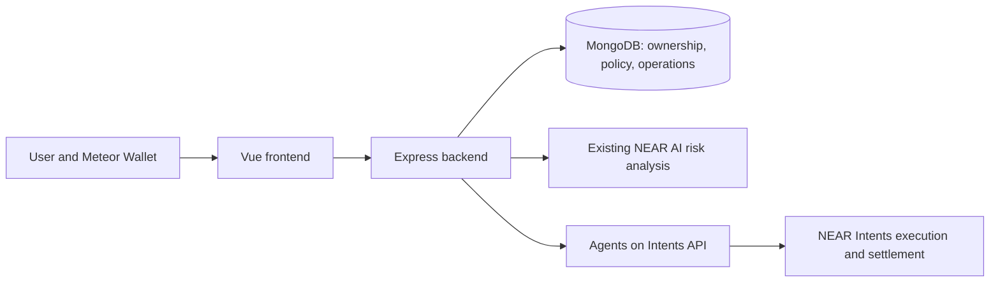

# SpendGuard AI

SpendGuard lets a user configure an AI trading agent without giving it unrestricted access to their funds. A verified NEAR wallet owns the agent, a signed policy limits spending, NEAR AI assesses each swap, and the backend binds approval to the exact request before submitting it to Agents on Intents.

## What works

- Meteor wallet ownership verification with NEP-413, full-access-key verification, and revocable HttpOnly sessions.
- Owner-scoped agents, versioned policies, exact token amounts, encrypted grant credentials, and wallet authorization reviews.
- Token catalog and available agent balances from the provider; backend enforcement of per-swap and rolling 24-hour spending limits.
- Dry-run swap previews, the existing NEAR AI `ALLOW`/`WARN`/`BLOCK` analysis, exact-operation approval, stable idempotency keys, and status reconciliation.
- Agent, policy, authorization, swap, and activity screens, with mobile navigation and retry states.
- Automated security and browser tests. Browser tests exercise the real Meteor SDK transport with synthetic wallet/provider responses.

**Live integration status:** a real Meteor ownership proof remains unconfirmed because the user's Meteor web wallet reports no locally available Mainnet account. Mainnet grant signing, funding, swap execution, and settlement have not been validated with real funds. Public submission is prepared as documentation and has not been published. Automated tests do not establish a completed mainnet integration.

## Architecture



The backend enforces ownership, grants, policy, balance, quote freshness, risk, and approval. NEAR AI is advisory and cannot override a failed mandatory check. Grant tokens and partner credentials stay on the backend; wallet private keys stay in Meteor. The original anonymous transaction-analysis endpoints remain available and exclude owner-linked operation records.

## Local setup

Use Node.js 24 or newer (the official provider SDK requires it). MongoDB must permit index creation. From the project root:

```sh
npm run setup
```

This installs both packages and creates the ignored `backend/.env` if needed, with a random grant-encryption key and live execution disabled. Existing credentials are preserved. Configure these server-side values in `backend/.env`:

```dotenv
MONGODB_URI=<your development MongoDB connection>
NEAR_AI_API_KEY=<your NEAR AI key>
NEAR_AI_MODEL=<your NEAR AI model>
AGENTS_ON_INTENTS_PARTNER_API_KEY=<your partner key>
CLIENT_URL=http://localhost:5173
NEAR_NETWORK_ID=mainnet
ENABLE_LIVE_EXECUTION=false
```

Keep `GRANT_ENCRYPTION_KEY` private and backed up. Changing it makes existing stored grant tokens unreadable. Never use `VITE_` variables for backend credentials.

If an older wallet unique index prevents startup, inspect `npm --prefix backend run migrate:wallet-index` and follow [the index migration procedure](backend/docs/wallet-verification.md).

```sh
npm run dev
```

Open **http://localhost:5173**. The API runs on port 3000; the frontend forwards `/api`. On Windows, use `npm.cmd` if PowerShell blocks `npm.ps1`. Only start one server on each port.

## Try the workflow

1. Connect the Mainnet wallet and review/sign the ownership message in Meteor. This initial message does not authorize spending.
2. Open **Agents & Policies**. Choose a name, token pair, per-swap and daily limits, balance source, and approval requirement. Prepare and review the exact creation payload, then sign it. The agent becomes active only after its policy is confirmed applied.
3. Prepare a time-limited agent authorization and sign its exact message. The backend stores only encrypted grant credentials. Updating a policy requires a new policy version and new local authorization.
4. Fund the agent's balance through the provider's documented deposit workflow. Your personal wallet balance is separate from the agent balance; SpendGuard never moves funds into the agent automatically.
5. Open **Swaps**, specify the amount and a positive minimum output, and request the preview. Amounts in the interface use token units and are converted exactly to atomic integers.
6. Review the minimum output, available estimate, fees, warnings, expiry, and NEAR AI result. `BLOCK` prevents execution; analysis failure holds it for review. Approve or reject the exact preview.
7. For controlled validation only, follow [the mainnet runbook](backend/docs/mainnet-validation.md). Enabling execution alone never sends a transaction: an explicit execution action and any required provider wallet vote are still necessary.
8. Track the original operation in **Activity Logs**. `UNCERTAIN` work is reconciled under its original correlation ID; it is never blindly submitted again. `NEEDS_REVIEW` stops routine polling until provider resolution.

The current Meteor adapter supports provider **NEP-413 message intents**. An unsupported signing standard is refused, rather than converted into a different signature or broadcast transaction. The provider can describe additional standards in its API; those require a compatible wallet adapter before use.

## Validation

```sh
npm test
npm run build
npm --prefix backend run test:database
```

`test:database` creates a randomly named isolated MongoDB database, checks real indexes and concurrent dispatch locking, and removes only that test database. It never tests against the application's database or sends a provider transaction.

For browser tests:

```powershell
cd frontend
$env:SPENDGUARD_BROWSER_PORT='5175'
$env:SPENDGUARD_BROWSER_BUILD='1'
npm.cmd run test:browser
```

Browser tests use headless Edge by default. For Chromium, install it with `npx playwright install chromium` and set `PLAYWRIGHT_CHANNEL=chromium`. All wallet signatures, grants, quotes, and settlement responses in these tests are synthetic.

## Implementation phases and provenance

The repository already had the Vue security dashboard, anonymous transaction analysis, NEAR AI integration and knowledge files, and the Agents on Intents HTTP client before the domain/wallet phases. These remain in use. The domain and wallet commits added ownership, models, and wallet sessions. The remaining implementation adds agent/policy/grant workflows, swaps, operation approvals and reconciliation, frontend management screens, security tests, and packaging.

See [the phase acceptance record](backend/docs/phase-status.md), [API and security contracts](backend/docs/workflow.md), and [demo/submission preparation](backend/docs/demo.md). All phase statuses distinguish implemented behavior from live validation and publication.

Official provider references were downloaded from [OpenAPI](https://api.agentsonintents.com/openapi.json) and [the integration reference](https://api.agentsonintents.com/llms.txt). Versioned snapshots are retained under `backend/docs/`; the existing HTTP client is used for endpoints, and `@near-intents-agent-api/sdk@0.9.0` supplies the token credential helpers only.

## Deployment

Run the backend production build with `npm --prefix backend start`, host `frontend/dist` behind the same HTTPS origin, and proxy `/api` to the backend. Set `NODE_ENV=production` and the exact HTTPS `CLIENT_URL`. Keep database and encryption credentials in a server secret store, preserve encryption keys across deployments, and add gateway rate limits for multiple API instances. The API starts only after its indexes are ready. Run the test/build checks before enabling execution.

Licensed under [MIT](LICENSE).
